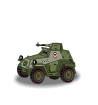
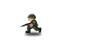
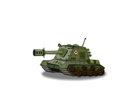
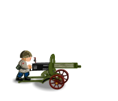
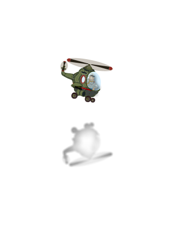

# Original asset previews

Thirty first-frame reference exports from the untouched embedded SWF. These are composition/silhouette references, not complete animation sequences. Blank/partial first frames are possible for effects; consult the timeline inventory for animation labels and nested clips.

| symbol | id | frames | preview | states |
| --- | --- | --- | --- | --- |
| UnitTankLite | 1043 | 99 | [First frame](reference/previews/DefineSprite_1043_UnitTankLite_UnitTankLite/1.png) | stay, move, stayBr, moveBr, stayFire, moveFire, die, shoot, shootBr, shootFire |
| UnitCannonNormal | 1087 | 70 | [First frame](reference/previews/DefineSprite_1087_UnitCannonNormal_UnitCannonNormal/1.png) | full, break, fire, die, shootFull, shootBr, shootFr |
| UnitMortar | 1142 | 70 | [First frame](reference/previews/DefineSprite_1142_UnitMortar_UnitMortar/1.png) | full, break, fire, die, shootFull, shootBr, shootFr |
| UnitRocketLite | 1178 | 99 | [First frame](reference/previews/DefineSprite_1178_UnitRocketLite_UnitRocketLite/1.png) | stay, move, stayBr, moveBr, stayFire, moveFire, die, shoot, shootBr, shootFire |
| ContentBulletSFX | 1190 | 20 | [First frame](reference/previews/DefineSprite_1190_ContentBulletSFX_ContentBulletSFX/1.png) | Nested animation/static composition |
| UnitCannonSmall | 1243 | 70 | [First frame](reference/previews/DefineSprite_1243_UnitCannonSmall_UnitCannonSmall/1.png) | full, break, fire, die, shootFull, shootBr, shootFr |
| UnitCannonBig | 1262 | 70 | [First frame](reference/previews/DefineSprite_1262_UnitCannonBig_UnitCannonBig/1.png) | full, break, fire, die, shootFull, shootBr, shootFr |
| UnitOMPAtom | 1289 | 64 | [First frame](reference/previews/DefineSprite_1289_UnitOMPAtom_UnitOMPAtom/1.png) | Nested animation/static composition |
| UnitBTRLite | 1349 | 99 | [First frame](reference/previews/DefineSprite_1349_UnitBTRLite_UnitBTRLite/1.png) | stay, move, stayBr, moveBr, stayFire, moveFire, die, shoot, shootBr, shootFire |
| UnitOMPMine | 1381 | 1 | [First frame](reference/previews/DefineSprite_1381_UnitOMPMine_UnitOMPMine/1.png) | Nested animation/static composition |
| UnitSoldatBazooka | 1387 | 91 | [First frame](reference/previews/DefineSprite_1387_UnitSoldatBazooka_UnitSoldatBazooka/1.png) | Run, Shoot, d1, d2, d3, d4, d5, d6, d7 |
| ContentScreenMainMenu | 265 | 1 | [First frame](reference/previews/DefineSprite_265_ContentScreenMainMenu_ContentScreenMainMenu/1.png) | Nested animation/static composition |
| ContentScreenCredits | 269 | 1 | [First frame](reference/previews/DefineSprite_269_ContentScreenCredits_ContentScreenCredits/1.png) | Nested animation/static composition |
| UnitSoldatAK | 440 | 90 | [First frame](reference/previews/DefineSprite_440_UnitSoldatAK_UnitSoldatAK/1.png) | Run, Shoot, d1, d2, d3, d4, d5, d6, d7 |
| ContentScreenHelp | 465 | 1 | [First frame](reference/previews/DefineSprite_465_ContentScreenHelp_ContentScreenHelp/1.png) | Nested animation/static composition |
| UnitRocket | 556 | 99 | [First frame](reference/previews/DefineSprite_556_UnitRocket_UnitRocket/1.png) | stay, move, stayBr, moveBr, stayFire, moveFire, die, shoot, shootBr, shootFire |
| UnitTank | 634 | 99 | [First frame](reference/previews/DefineSprite_634_UnitTank_UnitTank/1.png) | stay, move, stayBr, moveBr, stayFire, moveFire, die, shoot, shootBr, shootFire |
| UnitOMPAvia | 639 | 1 | [First frame](reference/previews/DefineSprite_639_UnitOMPAvia_UnitOMPAvia/1.png) | Nested animation/static composition |
| ContentScreenUIGame | 647 | 1 | [First frame](reference/previews/DefineSprite_647_ContentScreenUIGame_ContentScreenUIGame/1.png) | Nested animation/static composition |
| ContentLargeSFX | 689 | 20 | [First frame](reference/previews/DefineSprite_689_ContentLargeSFX_ContentLargeSFX/1.png) | Nested animation/static composition |
| ContentScreenPause | 699 | 1 | [First frame](reference/previews/DefineSprite_699_ContentScreenPause_ContentScreenPause/1.png) | Nested animation/static composition |
| UnitMaxim | 819 | 70 | [First frame](reference/previews/DefineSprite_819_UnitMaxim_UnitMaxim/1.png) | full, break, fire, die, shootFull, shootBr, shootFr |
| ContentScreenLevelFailed | 846 | 1 | [First frame](reference/previews/DefineSprite_846_ContentScreenLevelFailed_ContentScreenLevelFailed/1.png) | Nested animation/static composition |
| UnitHeli | 889 | 1 | [First frame](reference/previews/DefineSprite_889_UnitHeli_UnitHeli/1.png) | Nested animation/static composition |
| ContentBarrage | 892 | 1 | [First frame](reference/previews/DefineSprite_892_ContentBarrage_ContentBarrage/1.png) | Nested animation/static composition |
| ContentScreenGame | 901 | 1 | [First frame](reference/previews/DefineSprite_901_ContentScreenGame_ContentScreenGame/1.png) | Nested animation/static composition |
| UnitBTR | 926 | 99 | [First frame](reference/previews/DefineSprite_926_UnitBTR_UnitBTR/1.png) | stay, move, stayBr, moveBr, stayFire, moveFire, die, shoot, shootBr, shootFire |
| ContentScreenLevelVictory | 945 | 1 | [First frame](reference/previews/DefineSprite_945_ContentScreenLevelVictory_ContentScreenLevelVictory/1.png) | Nested animation/static composition |
| Background | 988 | 1 | [First frame](reference/previews/DefineSprite_988_Background_Background/1.png) | Nested animation/static composition |
| ContentSmokeSFX | 992 | 59 | [First frame](reference/previews/DefineSprite_992_ContentSmokeSFX_ContentSmokeSFX/1.png) | Nested animation/static composition |

## Selected unit references

### UnitBTRLite

### UnitSoldatAK

### UnitTank

### UnitMaxim

### UnitHeli

