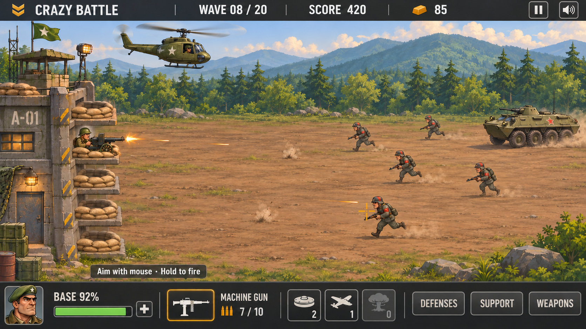

# Crazy Battle — proposed art direction

Step 2 · 11 November 2026 · Direction for review, not yet implemented in the game.

## Direction

**Painted military arcade.** A sunlit forest outpost, sturdy exaggerated military silhouettes, crisp tactical controls, and warm amber feedback. Keep the original's approachable humor and immediate base-defense readability. Depth comes from lighting, material separation, animation, and selective detail.

The concept establishes the visual target; [design-tokens.json](design-tokens.json) establishes proposed implementation values. Generated text, exact symbol details, and geometry in the concept are illustrative. Values, hitboxes, and layout will be authored in code in the next stages.

View the [visual guide](http://127.0.0.1:8765/docs/art-direction/index.html) or open `index.html` beside this document. Version 2 corrects the selected machine-gun icon; version 1 is retained as an earlier concept.

## Composition and perspective

- Native target: **960×540**, 16:9. Top HUD 40 px, bottom HUD 72 px; 428 px between them for scene composition. World and HUD are separate render layers.
- Left base holds exactly five vertically arranged emplacement positions. Four empty sandbag positions and one occupied gun in the concept explain the mechanic without a tutorial wall.
- Enemy travel reads right-to-left; the friendly helicopter faces right. Use a shallow elevated side view, with a stable horizontal ground plane. Avoid dramatic perspective or camera rotation.
- Reserve the middle for combat. Put scenic texture at the edges; distant mountains and forest are lower contrast. Do not let foreground foliage cover targets or slots.
- Art is drawn at its correct proportions. Adapt world-to-screen composition deliberately rather than widening sprites. Keep unit ranges, spawn timing, travel pressure, and lane targeting equivalent to the reference specification.
- Battlefield rendering fills the viewport. Fullscreen expands the presentation without black bars; character sprites retain proportions. A final policy for extra-wide screens is a step-3 layout decision, not permission to stretch characters or reveal extra tactical space for free.
- The concept shows a mid-campaign illustration: wave 8, machine gun, light BTR and consumables. Its sample values are not a new starting loadout. The first playable wave still starts with Cannon, 800 HP, no money, and no consumables.

## Palette

| Role | Value | Use |
| --- | --- | --- |
| Canvas | `#13191D` | Screen surroundings and deep surfaces. |
| UI surface | `#20282D` | HUD and modal panels. |
| Raised surface | `#303B40` | Buttons and selected/hovered panel surfaces. |
| Stroke | `#566168` | Quiet panel divisions; not body text. |
| Primary text | `#F4F0E7` | Labels, important values, icons. |
| Secondary text | `#B4BABD` | Context and supporting values. |
| Action amber | `#F3B544` | Selection, focus, currency, primary action. Use dark ink `#171C20` on filled amber. |
| Health | `#8BCB59` | Health state only; pair with percentage/bar. |
| Danger | `#ED665E` | Damage/critical state; pair with warning icon/text. |
| Deep forest | `#324A3A` | Close vegetation and friendly military materials. |
| Mid forest | `#667B4B` | Lit vegetation, cloth variation. |
| Terrain | `#A87848` | Warm dirt and dust family, with restrained variation. |
| Distance | `#819CA4` | Atmospheric mountain/sky family. |

Keep the battlefield warm and the interface cool. Amber is a highlight, not a full-screen wash. Do not encode allegiance, disabled state, or damage using color alone. Enemy silhouette/equipment and small insignia distinguish units even without red accents.

## Typography and spacing

Prototype display stack: **Bahnschrift → Arial Narrow → sans-serif**. Body stack: **Segoe UI → Arial → sans-serif**. The local guide uses system fonts; it does not distribute font files or require remote font requests. Confirm the final redistributable font choice before packaging.

At 960×540: title 36 px; panel headings 28 px; HUD values 20 px; buttons/body 16 px; secondary labels 14 px. Use tabular numerals for money, ammo, wave and score. Display headings may be uppercase; teaching and descriptive text use sentence case. No outlined/slanted body lettering or text stamped over noisy camouflage.

Use 4/8/12/16/24/32 px spacing, 6 px control corners, 1 px quiet outlines, and 2 px focus rings. Icon artwork is generally 24 px inside a minimum 40 px input target; ability tiles 44 px. Every clickable target must map through responsive/fullscreen scaling consistently.

## HUD hierarchy and information

1. **Threat and aim:** enemies, impacts, reticle and base condition must remain readable during action.
2. **Wave and resources:** compact top HUD presents wave/20, points, money, pause and sound.
3. **Loadout:** bottom HUD presents base repair/health, selected weapon/ammo, owned consumable counts, and preparation-panel navigation.

Proposed bottom allocation at 960 px: base/portrait/repair 240 px; weapon/ammo 208 px; three ability tiles 160 px; three panel buttons 304 px; outer insets/gaps 48 px. This is a layout starting point to validate at real size, not fixed world geometry.

Use explicit navigation names **Defenses / Support / Weapons** to match their actual functions. During combat, purchasing navigation is visibly locked; existing stock can still be deployed. Hover/focus explains “Available between waves” where space allows. A zero-stock item shows icon + 0 + disabled treatment; it never looks selected.

Reticle is a fine amber cross with a short high-contrast backing stroke, not a large animated sight obscuring infantry. Ammo uses count and progress, with a clear “Reloading” state. Currency icon is earned supply, not a purchasable premium currency.

## Component states

| State | Treatment |
| --- | --- |
| Default | Dark raised surface, quiet border, cream label. |
| Hover | Slight surface lift and stronger border; no large scale animation. |
| Pressed | Darker/inset surface, short 1 px visual offset. |
| Keyboard focus | Separate 2 px amber focus outline; visible regardless of hover. |
| Selected | Amber border + small marker; does not rely on glow alone. |
| Owned | Check/owned indicator distinct from affordable-but-unowned. |
| Unaffordable | Muted art, readable price, lock or shortage label. |
| Combat-locked | Muted panel action plus lock, explanatory hint. |
| Danger | Red icon/state message; preserve readable text and numerical health. |

For touch targets and narrower displays, scale layout deliberately and verify targets; shrinking the entire desktop HUD indefinitely is not an accessibility plan. Mobile controls are not newly promised gameplay scope.

## Environment and character treatment

**Environment:** painted terrain with broken-up tracks, stones, grass and restrained craters. No repetitive fabric texture. Layer distant sky/mountains, forest band, battlefield surface, base, units, effects and interface. Ground texture beneath infantry is lower frequency/contrast than unit edges.

**Base:** concrete, sandbags, worn steel and small warm lamps. Emplacement positions remain separate and obvious. Damage adds cracks, small smoke and state changes rather than hiding repair/placement targets. The tall concept outpost is scenic set dressing; the base still has one shared HP pool.

**Infantry:** distinct helmet/weapon silhouettes, slightly enlarged heads/hands, compact painted shading, clean feet contact. Rifle and bazooka troops must differ at a glance. Keep death effects brief and readable without escalating graphic violence.

**Vehicles:** chunky forms, large visible weapon profile, clear wheel/track rhythm. Distinguish light/heavy versions by mass and equipment before color. Normal, damaged and burning states must remain recognizable through smoke.

**Friendly helicopter:** stable readable silhouette, subtly animated rotor, restrained tilt, visible weapon mount. Do not add pilots, helicopter health, separate flight mechanics or upgrade trees to the playable rules merely because the illustration suggests detail.

**Production sizes:** create backgrounds at 1920×1080 or larger in separate layers; aim for unit textures at roughly 2× intended display footprint. Infantry might occupy about 28–40×40–60 screen pixels depending on lane, but prototype against the original hit shapes before fixing final sprite bounds. Pixel dimensions are production guidance, not hitbox definitions.

## Animation, effects and sound direction

Preserve simulation timing and damage events from [the gameplay specification](../GAMEPLAY-SPEC.md). Cosmetic animation may interpolate at the render refresh rate. Do not tie damage to the duration of a newly drawn explosion.

| Family | Visual requirement |
| --- | --- |
| Infantry | Run, attack/recoil, hit feedback, death variants. |
| Vehicles | Move/idle/attack, normal/damaged/burning, death. |
| Defenses | Idle/attack in full/damaged/burning states, destruction. |
| Helicopter | Entry, rotor loop, vertical following/tilt, firing mount. |
| Consumables | Placement preview/mine trigger, bombing pass, Atom blast. |
| UI | 100 ms hover, 70 ms press, 180 ms panel, 260 ms results reveal. |

Effects: short ~60 ms muzzle flash, ~80 ms hit flash, compact dust/debris, warm readable explosion core, smoke that becomes transparent quickly. Small shake only for meaningful explosions; provide Off/Low settings later. Reticle and interface stay stable. Limit persistent debris and overlapping smoke.

Audio: distinct weapon attacks/impacts, quieter rotor and ambience under important cues, restrained achievement stinger. Plan separate master/music/effects controls and voice limits. No audio files are generated in step 2.

## Menu and overlay direction

- **Main menu:** illustrated outpost at rest, title and clear Continue / New Campaign / Settings actions. Use the same palette and materials as gameplay.
- **Teaching:** a compact contextual prompt for aiming, repairs and purchases. The first machine-gun concept prompt applies only to the selected weapon; starter Cannon instructions must say click to fire.
- **Preparation:** show price, owned status, unavailable reason and placement preview. Avoid three ambiguous decorative buttons.
- **Victory:** concise result card with wave completed, earnings, base condition, Upgrade / Next Wave. Score rules remain unchanged.
- **Defeat:** explain base lost, show result, Retry / Main Menu. No purchase prompt or portal service.
- **Final results/achievements:** distinct badge families in a restrained dark panel. Remove the large old commander modal that blocks most of combat.

These screens are described here, not fully illustrated or implemented in this stage.

## First polished-wave production list

| Priority | Deliverable | Acceptance |
| --- | --- | --- |
| P0 | Native 16:9 battlefield layers + five-slot base | Correct lane/slot layout, quiet center, no stretched art or border. |
| P0 | Rifle soldier animation family | Readable run/shoot/death, independent logical hit region. |
| P0 | Helicopter + starter Cannon mount | Original follow/fire behavior, correct aspect. |
| P0 | HUD and input-state components | Health/wave/score/money/ammo, accurate pointer mapping. |
| P0 | Starter impact/projectile/audio family | Hits and misses clear without changing damage timing. |
| P0 | Tutorial, pause, victory/defeat components | Complete first-wave flow. |
| P1 | One Maxim emplacement + icon | Validate placement, automatic targeting, repair/sale visuals. |
| Later | Remaining seven enemies, four defenses, three additional player weapons, consumables, campaign/menu illustrations | Expand only after the polished slice validates the shared style. |

Machine gun, BTR and stock icons in the concept demonstrate eventual visual coverage. Their production is not a requirement to expand the first-wave gameplay scope.

## Review and implementation boundary

The visual target is ready for review. Before large-scale production, assess: painted style vs original cartoon tone; battlefield/units at actual 960×540; five-slot clarity; HUD readability; desired degree of military exaggeration.

Step 3 will implement the browser foundation and layout. Step 4 will implement combat with placeholders. Step 5 will validate this art direction in one polished playable wave. None of those stages is silently included here.

## Generation provenance

Built-in image generation was used; no CLI/API fallback. The exact [generation prompt](gameplay-concept-prompt.txt) and [icon refinement prompt](gameplay-concept-refinement.txt) are saved. `gameplay-concept-v1.png` is the initial proposal; `gameplay-concept-v2.png` is the selected refinement. The generated raster is approximately 16:9; the local review presents it in the target composition. Production will author the 960×540 layout numerically, rather than treating the raster as a functional UI.
